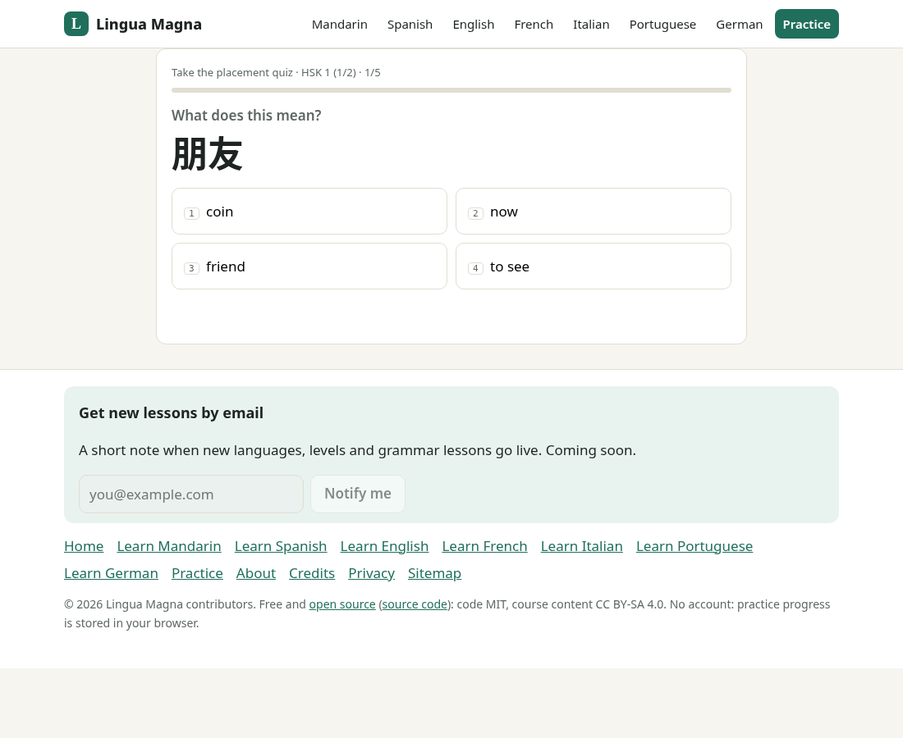
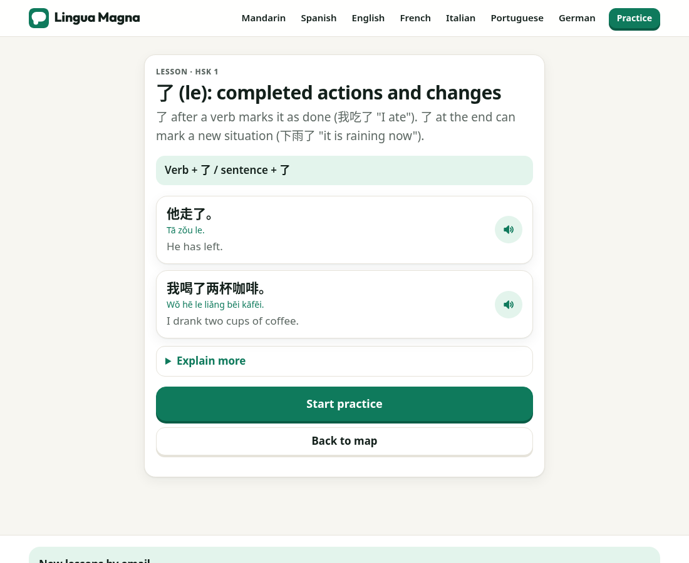
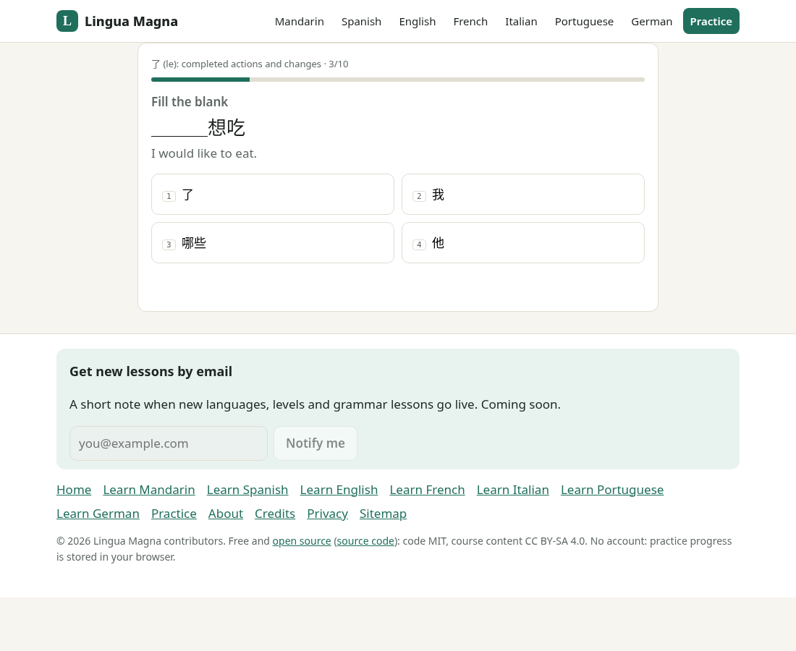
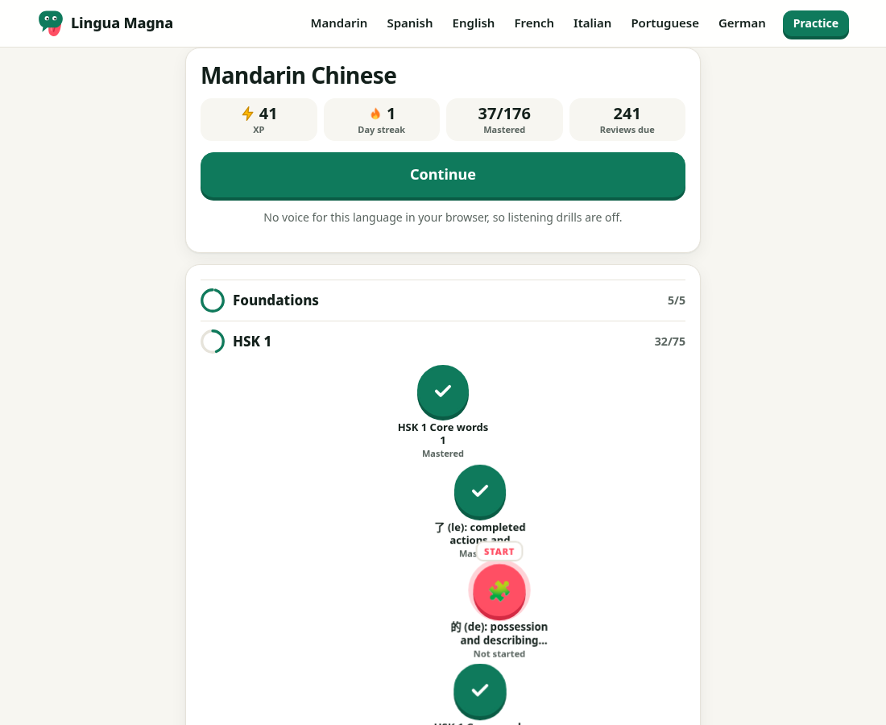
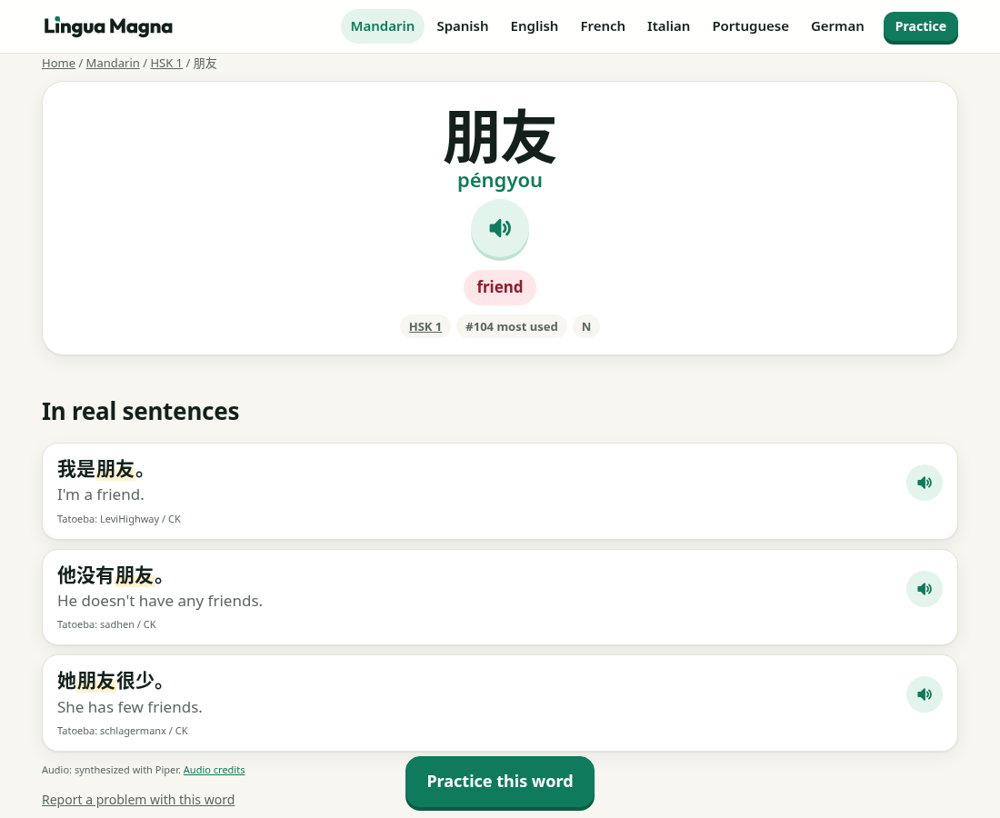

# Lingua Magna

**Don't just learn a language. Master it.** Lingua Magna (Latin for "great language") is a free, open-source, mastery-based language course that runs in the browser.

**Try it:** [linguamagna.pages.dev](https://linguamagna.pages.dev). No account, no ads, no tracking. Progress stays in your browser.

**Courses (7 languages):**

- **Mandarin Chinese:** HSK 3.0 levels 1-2, with tones and character writing
- **Spanish:** 2,000 words, A1-B1
- **English** for Spanish, Portuguese and Chinese speakers (A1-A2)
- **French, Italian, Portuguese and German:** 600-word starter courses (A1-A2)

Think "Math Academy for languages": a placement quiz, a skill graph where each concept unlocks only once its prerequisites are mastered, FSRS spaced review, and mastery checks.

On top of the app there is a free reference layer built from the same data: a hub per language, level pages, a page for every word and Mandarin character, and a page for every grammar lesson, all linking into practice.

| Placement | Lesson | Review | Dashboard | Word page |
|---|---|---|---|---|
|  |  |  |  |  |

**Open source:** code is MIT ([`LICENSE`](LICENSE)); course content, pack data and generated audio are CC BY-SA 4.0 ([`LICENSE-CONTENT`](LICENSE-CONTENT)). Every third-party dataset, recording and license is in [`NOTICE.md`](NOTICE.md). Want to fix a word or add a language? See [`CONTRIBUTING.md`](CONTRIBUTING.md).

## Contents

- [What it does](#what-it-does)
- [Counts](#counts)
- [Quick start](#quick-start)
- [Project structure](#project-structure)
- [How content and data update](#how-content-and-data-update)
- [Audio and voices](#audio-and-voices)
- [Deployment](#deployment)
- [Affiliates and disclosure](#affiliates-and-disclosure)
- [Notes and known limits](#notes-and-known-limits)
- [Contributing](#contributing)
- [License](#license)

---

## What it does

| Part | What the learner gets |
|---|---|
| **Placement** (`/learn/?pack=zh&placement=1`) | Each level is split into two bands. 5 questions per band; 4 right marks the band (and everything before it) as mastered and seeds review cards. Stops at the first failed band. |
| **Skill graph** | Concepts are groups of 8-10 words, grammar lessons, and for Mandarin tones and stroke skills. Each lists prerequisites. The map on the dashboard shows status per concept. |
| **Mastery** | Ported from Mathua (MIT): unseen, learning, practicing, mastered, decaying. Mastered = a streak of correct answers (6-8) at an average speed under the concept's time target. 14 days unseen = decaying. |
| **Scheduler** | Keeps working the frontier of unlocked concepts (in-progress first, then by level and graph depth so word tracks interleave), with about 30% of each 10-exercise session from due reviews. A 5-question mastery check every 50 XP. |
| **Spaced review** | Every word (and drawn character) has its own FSRS card via `ts-fsrs`. Grade comes from correctness and speed. |
| **Exercises** | Recognition (word to meaning), recall (meaning to word; typed for Latin-script languages, accent-tolerant), cloze from real Tatoeba sentences, listening with recorded or synthesized audio clips (see [Audio and voices](#audio-and-voices)), Mandarin tone drills (single tones, neutral tone, tone pairs, sandhi), Hanzi Writer stroke quizzes. |
| **Base language** | The English pack can be taught from Spanish, Portuguese or Chinese. Glosses, sentence translations, grammar explanations and the whole app UI switch with the base. Other packs use English. |
| **Local-first** | `localStorage` keys `lm:v1:<pack>:<base>` and `lm:settings`. Export / import / reset in settings. |

## Counts

From `data/packs/*.json` on this branch:

| Pack | Levels | Concepts | Words | Characters | Grammar lessons | Example sentences |
|---|---|---|---|---|---|---|
| Mandarin (`zh`) | foundations, HSK 1, HSK 2 | 176 | 1,221 | 599 | 16 | 3,475 |
| Spanish (`es`) | A1, A2, B1 | 216 | 2,000 | | 14 | 6,169 |
| English ESL (`en`, bases es/pt/zh) | A1, A2 | 89 | 800 | | 8 | 2,533 |
| French (`fr`) | A1, A2 | 69 | 600 | | 6 | 1,886 |
| Italian (`it`) | A1, A2 | 68 | 600 | | 6 | 1,900 |
| Portuguese (`pt`) | A1, A2 | 67 | 600 | | 6 | 1,879 |
| German (`de`) | A1, A2 | 67 | 600 | | 6 | 1,881 |

A full build writes about 7,100 pages, 6,779 of them in the sitemap. Word pages with fewer than 2 example sentences, and character pages used by fewer than 2 words, are `noindex` (thin-page rule) and left out of the sitemap.

## Quick start

**You need:** Node 20 or newer (`.nvmrc` pins 22 for local work) and npm. Playwright's Chromium is only needed for `npm run verify` and the screenshot scripts.

```bash
git clone https://github.com/rchrdchn/lingua-mastery && cd lingua-mastery
npm install
npm run build      # typecheck, bundle, Eleventy (~7,100 pages, ~20 s), postbuild checks
npm run serve      # http://localhost:8080/
```

| Command | What it does |
|---|---|
| `npm run build` | Typecheck, bundle the app, build the site to `_site/`, then postbuild checks. |
| `npm run serve` | Serves `_site/` on http://localhost:8080/. |
| `npm run dev` | Eleventy dev server (rerun `npm run engine` after TypeScript changes). |
| `npm test` | Engine unit tests and the gloss check. |
| `npm run check` | Internal link check, and every sitemap URL has 2+ inbound links. |
| `npm run verify` | Playwright run-through (placement, lesson, review) with the system Chrome; `PW_CHANNEL=chromium` uses Playwright's own. |
| `npm run typecheck` | TypeScript only. |
| `npm run engine` | Bundles `src/app/` and copies the stroke data. |
| `npm run data:fetch` / `data:build` | Download raw sources / rebuild the packs (see below). |
| `npm run data:lint` | Gloss quality check on the top 600 words of each pack. |
| `npm run indexnow` | Pings IndexNow with changed URLs after a deploy. |
| `node scripts/audio-check.mjs` | Taps listen buttons and confirms audio bundles load and play (after a build). |

**Heads-up:** a build rewrites `lastmod.json`. Unless your change really updates page content, run `git checkout lastmod.json` before committing.

## Project structure

```
scripts/data/fetch.mjs        downloads raw sources to data/raw/   (gitignored, ~1.5 GB of downloads)
scripts/data/build-packs.mjs  raw sources + content/ -> data/packs/<id>.json   (committed)
content/grammar/<id>.mjs      original grammar lessons (CC BY-SA 4.0)
content/en-overrides.json     hand-checked ESL translations
src/engine/*.ts               the engine: graph, mastery, scheduler, review (FSRS), exercises, placement, session, store, audio, i18n
src/app/main.ts               the /learn/ app (plain DOM)   -> bundled to src/assets/app.js
src/app/strokes.ts            stroke animation on character pages -> src/assets/strokes.js
scripts/bundle.mjs            esbuild bundle + copies Hanzi Writer stroke JSON for the pack's characters to src/assets/strokes/
src/_data/lm.js               turns packs + lib/langs.js copy into page data
src/pages/*.njk               hub, level, word, character and grammar templates (Eleventy pagination)
lib/seo.js                    shared title/description/breadcrumb helpers (same as the other sites)
scripts/og.mjs                share cards (1200x630 PNG) into _site/og/; lib/og.js maps a URL to its card
scripts/og-fonts/             Outfit (OFL) and DejaVu Sans subsets used to draw card text as paths
scripts/postbuild.mjs         real lastmod from content hashes (lastmod.json), fails on long titles / double escaping
scripts/check.mjs             internal link check;  scripts/inlinks.mjs: every sitemap URL has 2+ inbound links
scripts/verify.mjs            Playwright run-through (placement -> lesson -> review), fails on console errors
test/engine.test.ts           engine unit tests, including "every concept in every pack yields valid exercises"
scripts/audio/                audio pipeline (plan, native-recording matchers, TTS, bundler, QA)
src/a/<pack>/                 pre-built audio bundles served by the site
data/audio/                   audio plan, matched recordings and credits.json
src/_data/affiliates.json     italki tutor link settings (the only affiliate config)
.github/ISSUE_TEMPLATE/       bug, data fix, grammar lesson and new language forms
```

Stack: Eleventy 3 (Nunjucks), TypeScript + esbuild, ts-fsrs, Hanzi Writer. No framework, no backend.

SEO: answer-first intros, a visible "Updated" date that matches JSON-LD `dateModified` and sitemap `lastmod`, one JSON-LD graph per page (Organization + WebSite, plus Course on hubs, CollectionPage + ItemList on levels, DefinedTerm on word and character pages, LearningResource on lessons, FAQPage where shown), BreadcrumbList from the visible crumbs, `sitemap.xml`, `llms.txt`, `llms-full.txt` (full text of every page llms.txt links, generated by `scripts/llms-full.mjs` at the end of the build), `feed.xml`, and a `robots.txt` that welcomes all crawlers including AI bots. Each course page lists its sources and licenses in the footer.

Share images: every hub, level and grammar lesson gets its own 1200x630 card (language, page title, a short hook and a big hero word), and each language has one card shared by its word pages (Mandarin also has one for character pages). Other pages use `src/og.png`. `scripts/og.mjs` runs after Eleventy, reads the built pages, and draws all text as vector paths (Outfit for Latin text, Hanzi Writer stroke data for Chinese), so builds do not depend on fonts installed on the build machine. About 100 cards, about 2 MB, about 6 seconds; unchanged cards come from `node_modules/.cache/og`. The build fails if a page points to a card that was not made. Tags: absolute `og:image` with width, height and alt, `twitter:card` summary_large_image. On branch previews (`CF_PAGES_BRANCH` other than main) the image URLs point at the branch alias, such as ux.linguamagna.pages.dev, so cards can be tested before merging; canonical URLs stay on production.

## How content and data update

- **Packs are committed.** Cloudflare builds never download sources; they build from `data/packs/*.json`.
- **To refresh or change data:** `npm run data:fetch` (once, or when a source releases an update) then `npm run data:build` (or one pack: `node --max-old-space-size=7000 scripts/data/build-packs.mjs es`). Commit the regenerated JSON. The builder is deterministic, so diffs show real changes.
- **Gloss quality:** `npm run data:lint` checks the top 600 words of each pack for grammar-note or overlong primary glosses (also part of `npm test`). Hand fixes live in `content/gloss-overrides/<lang>.json` and `content/en-overrides.json` (CC BY-SA 4.0).
- **Grammar and copy:** edit `content/grammar/<id>.mjs` or `lib/langs.js`, rebuild the pack (grammar) or just the site (copy).
- **Suggested routine:** refresh Tatoeba and Wiktionary data every 3-6 months (both grow continuously). HSK lists and frequency lists change rarely.
- `lastmod.json` is committed so "Updated" dates only move when a page's content really changes.

## Audio and voices

Every listen button plays a pre-generated MP3 clip. Clips are packed into small binary bundles in `src/a/<pack>/` and served as static files. The browser's `speechSynthesis` voice is only a fallback when a clip is missing.

**Where the audio comes from, in order of preference:**

1. **Native recordings with an open license:** Lingua Libre and Shtooka-project recordings on Wikimedia Commons for words, and Tatoeba sentence recordings whose own license is CC0, CC BY or CC BY-SA.
2. **Open text-to-speech** for everything else, run offline at build time: Kokoro-82M (Mandarin, Spanish, English, French, Portuguese), a Piper voice trained from scratch on a CC BY 4.0 dataset (Italian), and Coqui TTS Thorsten VITS trained on CC0 data (German).

Each voice was picked by comparing candidates with Whisper large-v3 scoring; the site's `/audio-test/` page plays the comparisons. Speakers, files and licenses are listed on each word page, on `/credits/`, in `data/audio/credits.json` and in [`NOTICE.md`](NOTICE.md#audio).

**Voice licensing rule: commercially clean only.** A voice or recording is used only if the model, the voice and the data it was trained on all allow commercial reuse (Apache-2.0, MIT, CC0, CC BY, CC BY-SA). That rules out NC or ND material, recordings with no reuse license, and voices fine-tuned from checkpoints whose base data isn't openly licensed.

**The pipeline** (`scripts/audio/`; the Python steps need their own virtualenvs with Piper, Kokoro or Coqui, plus `ffmpeg`):

| Step | Script | Output |
|---|---|---|
| 1. List every text the site can speak | `node scripts/audio/plan.mjs` | `data/audio/plan.json` |
| 2. Match native recordings | `ll_match.py`, `commons_match.py`, `zh_native.py`, `tatoeba_match.py` | `data/audio/ll-<pack>.json`, `tatoeba-<pack>.json` |
| 3. Synthesize the rest | `kokoro_zh.py` (Mandarin), `ext_tts.py` (Kokoro, Coqui and other engines); Piper runs inside `build.py` | WAVs in `$AUDIO_SRC` |
| 4. Trim, normalize, encode and bundle | `build.py [packs...]` | `src/a/<pack>/*.bin`, `data/audio/credits.json` |
| 5. Spot-check | `qa.py` (faster-whisper), then `node scripts/audio-check.mjs` | pass/fail report |

Each script's first lines document its arguments and environment variables (`PIPER_VOICES`, `AUDIO_CACHE`, `AUDIO_SRC`). The bundles and credits are committed, so a normal build never runs the audio pipeline.

## Outbound link tags

Standing rule (Oct 29, 2026): every link from this site to another site carries `utm_source=linguamagna.pages.dev&utm_medium=referral`, so the sites we send readers to see us in their analytics (and may come back to advertise). Links to our other sites get it too.

- **How:** The last build step, `node scripts/tag-outbound.mjs _site linguamagna.pages.dev lingua-mastery.pages.dev` (end of `npm run build`), rewrites the built HTML. It runs after `postbuild.mjs`, so the lastmod content hashes and IndexNow never see the tags. Only static HTML `<a>` and `<area>` links are changed; `<script>`, `<style>` and comments are skipped. The in-browser engine builds no outside links. This is a tag on links we send out, not tracking: nothing about the reader is collected here. When the site moves to its own domain, change the domain in the `build` script too. Nobody tags links by hand; new pages are covered automatically.
- **Format:** `?utm_source=linguamagna.pages.dev&utm_medium=referral` is added before any `#fragment`, with `&` when the URL already has a `?`. Existing parameters, `rel` (`sponsored`, `nofollow`, `noopener`), `target` and every other attribute stay as they were.
- **Left alone:** internal links (relative paths and this site's own hosts), `mailto:`, `tel:` and `javascript:` links, links that already have any `utm_` parameter, affiliate and payment links (Amazon and amzn.to, any `tag=` parameter, RunSignup `aflt_token=` links, Awin, Impact, ShareASale, CJ, Rakuten, Skimlinks, `buy.stripe.com`, beehiiv subscribe pages and embeds), and share, compose and add-to-calendar links (X intent, Facebook sharer, WhatsApp, Gmail and Outlook compose, Google Calendar). To exclude one link, add `data-no-utm` to the `<a>`.
- **Files:** `scripts/outbound-utm.mjs` holds the rules (the same file in every site's repo; change it in all of them together), `scripts/tag-outbound.mjs` walks `_site/` and fails the build if a second pass still finds an untagged link, and `scripts/outbound-utm.test.mjs` is the unit test (`node --test scripts/outbound-utm.test.mjs`).
- **Check live:** `curl -s https://linguamagna.pages.dev/ | grep -o 'href="https\?://[^"]*utm_source=linguamagna.pages.dev[^"]*"' | head`

## Deployment

The site is a Cloudflare Pages project connected to the GitHub repo.

- **Live preview:** https://linguamagna.pages.dev (Cloudflare Pages project `linguamagna`). Every push to `main` deploys automatically. The repo is still named `lingua-mastery`, and the old project at https://lingua-mastery.pages.dev keeps running until it is retired.
- Other branches get Cloudflare preview URLs. Work in progress goes to the `ux` branch first ([ux.linguamagna.pages.dev](https://ux.linguamagna.pages.dev)) and is merged into `main` after review.
- Production branch `main`, build command `npm run build`, output directory `_site`, environment variable `NODE_VERSION=20` (set in the Pages project; it takes precedence over `.nvmrc`, which pins Node 22 for local work). The build runs on Node 20 or newer.
- `url` in `src/_data/site.json`, the `Sitemap:` line in `src/robots.txt` and every canonical URL use `https://linguamagna.pages.dev`. When a real domain is chosen, change those two files, the `llms-full.mjs` URL in the `build` script and the llms comments in `src/robots.txt`, then rebuild; canonicals, sitemap, feed and `llms.txt` follow `site.json`.
- Keep Bot Fight Mode off so AI crawlers can read the site.
- After a deploy is live, `npm run indexnow` pings IndexNow with only the changed URLs (set `indexNowKey` in `site.json` and add the key file first).
- No secrets live in the repo. The Git integration needs none.

Optional settings in `src/_data/site.json`: `cfAnalyticsToken` (Cloudflare Web Analytics), `newsletterUrl` (the signup block renders only when it is set), `repoUrl` (the footer's source code link; set to https://github.com/rchrdchn/lingua-mastery).

## Affiliates and disclosure

Lingua Magna is free and has no ads. The one paid link is an optional italki tutor referral (Awin program: publisher 3126478, merchant 89661). italki pays a commission on a new student's first lesson purchase. The learner pays nothing extra.

**Where it shows**

- A "Practice with a real tutor" card at the end of every grammar lesson page, after the prev/next links (`src/_includes/tutor-card.njk`, included from `src/pages/grammar.njk`).
- The same card on each language hub (`/spanish/`, `/chinese/` and so on), after "About this course" and before the FAQ (`src/pages/hub.njk`).
- The same card, localized to the learner's interface language, on the `/learn/` "Session complete" screen, below Continue and Back to map (`tutorCard()` in `src/app/main.ts`).
- A small "Find a tutor" link in the footer's Product column (`src/_includes/base.njk`).

Each card links to italki's teacher search for the course being studied:

| Course | italki page |
| --- | --- |
| zh | https://www.italki.com/en/teachers/chinese |
| es | https://www.italki.com/en/teachers/spanish |
| en | https://www.italki.com/en/teachers/english |
| fr | https://www.italki.com/en/teachers/french |
| it | https://www.italki.com/en/teachers/italian |
| pt | https://www.italki.com/en/teachers/portuguese |
| de | https://www.italki.com/en/teachers/german |

The footer link goes to https://www.italki.com/.

**Turning it on**

The only file to edit is `src/_data/affiliates.json`. **Live since 2026-10-26:** Awin approved the italki program on 2026-10-25 and `italkiUrl` holds the Awin deeplink below (with `ued` set to the italki home page). Clearing `italkiUrl` turns everything off again: no card, no footer link, no untracked italki links. The deeplink format:

```
https://www.awin1.com/cread.php?awinmid=89661&awinaffid=3126478&ued=<url-encoded italki page>
```

`src/_data/tutor.js` swaps the `ued` value for each course's page, so one deeplink covers every language. To change a destination, edit `italkiPages` in the same file. Before you add one, check it returns 200 with `curl -s -o /dev/null -w '%{http_code}' <url>`. Use `https://www.italki.com/` for any language that has no page.

**Disclosure rules**

- Every card shows the disclosure right under its button: "We may earn a commission if you book a lesson through this link, at no extra cost to you." The footer adds a one-line note whenever the footer link is on.
- Every affiliate link has `rel="sponsored noopener"` and `target="_blank"`, plus a screen-reader note that it opens italki in a new tab.
- The card stays at the end of a lesson or session, never above lesson content, and never as a popup.
- The card sits between `<!--nohash-->` markers, so turning it on does not bump `lastmod` on every lesson page.

**Preview without a tracked link**

```
TUTOR_PREVIEW=1 npm run build && git checkout lastmod.json
node scripts/tutor-shots.mjs /workspace/lm-tutor-shots   # WebKit iPhone 15 + Chromium desktop
npm run build                                            # rebuild without the flag before deploying
```

`TUTOR_PREVIEW=1` renders the card with plain italki links, so use it only for screenshots and never deploy it. It does nothing once `italkiUrl` is set.

## Notes and known limits

- The Mandarin lists follow the **HSK 3.0 standard published in 2021** (500 + 772 words) via ivankra/hsk30, not a later exam syllabus.
- Glosses for the European packs come from Wiktionary and are mostly good, but some very common function words still have odd or overlong first senses. Fixes go in Wiktionary upstream or as overrides.
- Listen buttons play the pre-generated clips. The browser's `speechSynthesis` voice is only a fallback when no clip exists.
- Portuguese mixes Brazilian and European usage, as the sources do.

## Contributing

The most useful help is better language data: fixing a wrong meaning, adding a grammar lesson, or adding a language. Code fixes are welcome too. [CONTRIBUTING.md](CONTRIBUTING.md) covers setup, sourcing and voice rules, step-by-step examples and the pull request checklist.

Found a problem? Open an issue with the Bug, Data fix, Grammar lesson or New language form.

## License

| What | License |
|---|---|
| Code: engine, app, templates, build scripts, tests | MIT, see [`LICENSE`](LICENSE) |
| Content: language packs, grammar lessons, overrides, page copy, synthesized audio | CC BY-SA 4.0, see [`LICENSE-CONTENT`](LICENSE-CONTENT) |
| Third-party data and recordings | Their own licenses (Tatoeba sentences CC BY 2.0 FR, recordings per file), listed in [`NOTICE.md`](NOTICE.md) |

If you reuse the content, keep the attribution in `NOTICE.md` and share changes under the same license.

## Not affiliated

Lingua Magna is an independent project. It is not affiliated with or endorsed by Tatoeba, Wiktionary, Wikimedia, Lingua Libre, the HSK exam authorities, or the makers of the TTS models it uses. italki appears only through the affiliate program described above. The mastery model is adapted from the ideas in Mathua (MIT); no Mathua code or content is used.
